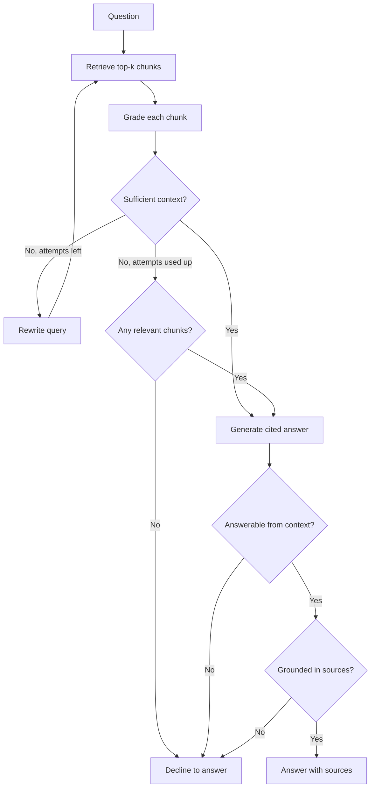

# Corrective RAG

Ask questions about your own documents and get answers with citations. When the documents don't contain the answer, the app says so instead of guessing.

A plain RAG app sends whatever it retrieves straight to the model. This one grades the retrieved passages first, rewrites the search query when they are weak, and checks the final answer against its sources.

## Features

- **Document upload:** PDF, DOCX, TXT and MD, with several files at once.
- **Relevance grading:** every retrieved chunk is scored, and weak ones are dropped.
- **Query rewriting:** the query is rewritten and retried when the context is not good enough.
- **Cited answers:** answers reference their passages as `[1]`, `[2]`, with the file name and page.
- **Groundedness check:** an answer that the sources don't support is not shown.
- **Pipeline trace:** see each attempt, the chunk scores and what was missing.
- **Local index:** embeddings and the vector store run on your machine. Only text generation uses an API.

## How it works



## Tech stack

| Part | Tool |
|---|---|
| UI | Streamlit |
| LLM | Groq API: `openai/gpt-oss-120b` for answers, `openai/gpt-oss-20b` for grading, rewriting and verification |
| Embeddings | `sentence-transformers/all-MiniLM-L6-v2` |
| Vector store | ChromaDB (persistent, cosine distance) |
| Chunking | LangChain text splitters |

## Getting started

You need Python (tested on 3.13) and a [Groq API key](https://console.groq.com/keys).

**1. Clone the repository**

```bash
git clone https://github.com/Kroush1/corrective-rag.git
cd corrective-rag
```

**2. Create and activate a virtual environment**

Windows (PowerShell):

```powershell
python -m venv .venv
.\.venv\Scripts\Activate.ps1
```

macOS / Linux:

```bash
python3 -m venv .venv
source .venv/bin/activate
```

**3. Install the dependencies**

```bash
pip install -r requirements.txt
```

**4. Add your API key**

Copy `.env.example` to `.env` and fill in your key:

```env
GROQ_API_KEY=your_key_here
```

`.env` is git-ignored, so your key stays out of the repository.

**5. Run the app**

```bash
streamlit run app.py
```

Streamlit prints the local address, usually http://localhost:8501. The first run downloads the embedding model.

## Usage

1. Upload one or more files in the sidebar.
2. Click **Index documents**.
3. Ask a question in the chat box.
4. Open **Sources** or **Pipeline trace** under an answer to see where it came from.

Uploading a file with the same name replaces the earlier version.

## Configuration

Set these in `.env`:

| Variable | Default | Purpose |
|---|---|---|
| `GROQ_API_KEY` | (required) | Groq API key |
| `CRAG_LLM_MODEL` | `openai/gpt-oss-120b` | Answer generation |
| `CRAG_FAST_MODEL` | `openai/gpt-oss-20b` | Grading, rewriting and verification |

These defaults live in `crag/config.py`. Those marked * can also be changed in the sidebar:

| Setting | Default | Purpose |
|---|---|---|
| `top_k` * | 6 | Chunks retrieved per attempt |
| `relevance_threshold` * | 0.6 | Minimum score to keep a chunk |
| `max_rewrites` * | 2 | Query rewrites after the first attempt |
| `verify_answer` * | `True` | Run the groundedness check |
| `max_context_chunks` | 5 | Chunks passed to the answer model |
| `chunk_size` / `chunk_overlap` | 900 / 150 | Chunk length and overlap, in characters |
| `embedding_model` | `all-MiniLM-L6-v2` | Embedding model |

After changing the embedding model, delete the `chroma_db/` folder and index your documents again.

## Project structure

```text
corrective-rag/
├── app.py              # Streamlit UI
├── crag/
│   ├── config.py       # Settings
│   ├── ingestion.py    # Extract, clean and split documents
│   ├── vectorstore.py  # ChromaDB storage and search
│   ├── grader.py       # Scores retrieved chunks
│   ├── rewriter.py     # Rewrites weak queries
│   ├── generator.py    # Cited answers and groundedness check
│   ├── llm.py          # Groq client
│   └── pipeline.py     # The corrective loop
├── requirements.txt
└── .env.example
```

## Limitations

- Scanned PDFs need OCR first, because only embedded text is extracted.
- Text inside DOCX tables is not extracted.
- The default embedding model is mainly English. For Arabic or other languages, consider `sentence-transformers/paraphrase-multilingual-MiniLM-L12-v2`.
- An answered question takes at least three API calls with verification on, and more when the query is rewritten. Groq rate limits can slow responses down.
- Retrieved passages are sent to the Groq API, so avoid documents you can't share with it.
